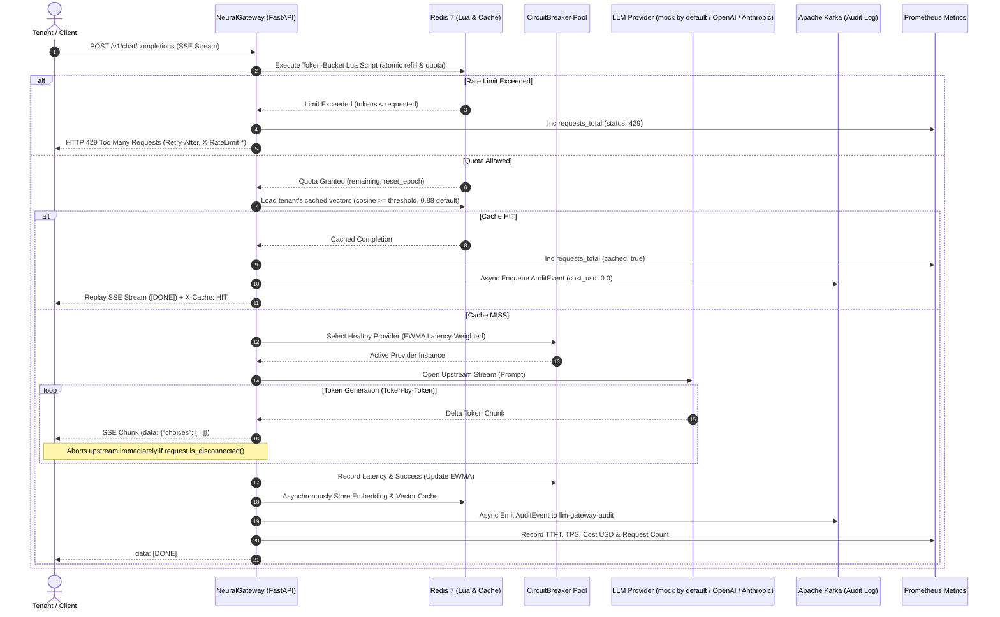

# NeuralGateway

<div align="center">

[](https://www.python.org/)
[](https://fastapi.tiangolo.com/)
[](https://www.docker.com/)
[](https://redis.io/)
[](https://kafka.apache.org/)
[](https://prometheus.io/)

**Multi-Tenant LLM Inference Gateway (prototype)**

</div>

---

> **Status: working prototype / portfolio project.** LLM providers are **simulated by default**
> (`DEMO_MODE=true`): `openai-primary` and `anthropic-secondary` are mock streams that return
> canned text after a random 35–110 ms first-token delay. Real OpenAI / Anthropic streaming is attempted only
> when `DEMO_MODE=false` **and** the matching API key is set. No load-test results are committed yet.

**Live demo (simulated providers, Render free tier):** <https://neural-gateway-core.onrender.com/>
(Swagger UI at `/docs`). Free-tier instances sleep or get suspended; on 2026-10-29 it returned
HTTP 503 on two attempts. Run it locally (below) for a reliable demo.

---

## Overview

**NeuralGateway** is a FastAPI service that sits in front of LLM providers and exposes an
OpenAI-style `POST /v1/chat/completions` endpoint (SSE streaming or buffered JSON). Each request
passes through a per-tenant token-bucket rate limiter (an atomic Redis Lua script), a similarity
cache of previous completions, EWMA latency-weighted provider selection guarded by 3-state circuit
breakers, and finally emits a Kafka audit event and Prometheus metrics. When Redis or Kafka are
unreachable it falls back to in-process implementations so it can run as a single container.

### Architecture Features

| Component | Strategy | Function |
| :--- | :--- | :--- |
| **Rate Limiting** | Token-bucket via Redis Lua (`app/rate_limiter.py`) | Single-roundtrip atomic quota check per tenant bucket; HTTP 429 with `Retry-After` / `X-RateLimit-*` headers. Fails open if Redis errors. |
| **Similarity Caching** | Cosine similarity on unit-normalized vectors (`app/cache.py`) | Replays a cached completion (JSON or SSE) when similarity ≥ `SEMANTIC_CACHE_SIMILARITY_THRESHOLD` (0.88 default, 0.92 in `docker-compose.yml`). Embeddings come from `sentence-transformers/all-MiniLM-L6-v2` **only if that package is installed**; it is not in `requirements.txt`, so the Docker image / Render demo use a deterministic hashed-token projection (stopword removal + suffix stemming + character 3-grams), which matches lexical rewordings rather than true paraphrases. |
| **Dynamic Routing** | EWMA inverse-latency weighting (`app/router.py`) | Picks a healthy provider with probability ∝ 1 / EWMA_latency^1.5. |
| **Circuit Breaking** | 3-State (`CLOSED` / `OPEN` / `HALF_OPEN`) (`app/circuit_breaker.py`) | Opens after 4 consecutive failures, probes after 15 s, closes after 2 probe successes. |
| **Failover** | Retry on another provider | Only if the provider fails **before the first token**; a mid-stream failure ends the stream without `[DONE]`. |
| **Disconnect Cancellation** | `request.is_disconnected()` checks | Stops pulling from the upstream generator when the client goes away. |
| **Audit Logging** | Bounded in-process queue → aiokafka (`app/kafka_producer.py`) | Request path never awaits Kafka; events are logged instead when no broker is reachable. |
| **Fallback Modes** | In-memory token bucket & cache | Keeps serving when Redis or Kafka are unavailable (per-process state). |

---

## Benchmarks

No benchmark results are committed yet, so this README makes no throughput or latency claims.
To produce reproducible numbers, run the gateway (ideally the full `docker compose` stack) and:

```bash
pip install locust   # not part of requirements.txt
locust -f locustfile.py --headless -u 100 -r 20 --run-time 1m \
  --host http://localhost:8000 --csv results/locust
```

Commit the generated `results/locust_stats.csv` together with the hardware, worker count,
`DEMO_MODE` value and whether Redis/Kafka were connected. Note that with mock providers the
latencies mostly reflect the artificial `asyncio.sleep` delays in `app/router.py`, and cached SSE
replays are deliberately paced at 5 ms per word (`app/main.py`).

---

## Limitations

- **Simulated providers by default**: with `DEMO_MODE=true` (the default, and the Render demo) every completion is canned mock text. Failover/circuit-breaker demos inject faults via the `X-Mock-Fail-Provider` header or the `/api/dashboard/trip-circuit` endpoint.
- **Real-provider errors are masked**: in real mode, if the OpenAI/Anthropic call raises or returns a non-200 status, the provider logs a warning and falls back to the mock text instead of raising, so the circuit breaker and failover never see real upstream failures.
- **Embedding model optional**: `sentence-transformers` is not installed by `requirements.txt` or the Dockerfile; `/healthz` reports `active_embedder` so you can see which embedder is active. Installing it adds torch and roughly 100+ MB RAM per worker.
- **Cache lookup is a linear scan**: each lookup loads every cached entry for the tenant (`SMEMBERS` + `HGETALL`) and computes dot products in Python; there is no vector index and `SEMANTIC_CACHE_MAX_ENTRIES` is not enforced.
- **Per-process state**: circuit breakers, EWMA latencies, the Kafka queue and Prometheus metrics live in each worker process. With `WORKERS>1` (compose uses 4) workers do not share breaker state, and `/metrics` reflects only the worker that served the scrape (prometheus_client multiprocess mode is not configured).
- **Rate-limiter clock**: the Lua script is atomic per bucket, but the refill timestamp is the gateway's `time.time()`, so clock skew between replicas affects refill accuracy. The limiter fails open on Redis errors.
- **No authentication**: tenants are identified by the client-supplied `X-Tenant-ID` header, CORS allows `*`, and the `/api/dashboard/*` admin endpoints (clear cache, trip/reset circuits, reset rate limits) are unauthenticated.
- **Approximate accounting**: "tokens" are whitespace word counts and cost is a flat per-1k rate from `app/config.py`; cache hits are recorded with `cost_usd=0.0` (embedding cost is not counted).
- **Audit durability**: the Kafka queue is bounded (10,000 events, oldest dropped when full) and is not drained on shutdown.
- **Single-Region Redis Dependency**: cache entries and rate-limit buckets live in a single Redis instance.
- **Upstream Provider Quotas**: gateway rate limiting does not sync with external provider organization quotas.

---

## Architecture & Request Lifecycle

The diagram shows the distributed mode (Redis + Kafka connected). In standalone mode Redis is
replaced by in-process stores and Kafka by log output; providers are mocks unless real mode is enabled.



---

## Interactive Web Control Center (`/`)

The root route `/` serves a single-page dashboard (`app/dashboard.py`) that drives the endpoints above:

1. **Live SSE Streaming Terminal**: send prompts, watch token-by-token delivery and the measured TTFT, and test client disconnect cancellation (logged as status `499`).
2. **Similarity Cache Demonstration**: send a base prompt (cache MISS, served by a mock provider), then a reworded prompt to see an `X-Cache: HIT` replay. The latency shown is measured in your browser and includes network time; no upstream cost is recorded for hits.
3. **3-State Circuit Breaker & Failover Lab**: trip `openai-primary` to `OPEN` and watch requests route to `anthropic-secondary` (both simulated).
4. **Rate Limiter Burst Test**: fire a 30-request burst (stays within the default 200-token bucket) or a 220-request burst (exhausts it) and inspect the HTTP 429 headers (`X-RateLimit-*`, `Retry-After`; these headers are only attached to 429 responses).
5. **Prometheus Telemetry Viewer**: in-flight streams, average TTFT, tokens/s and estimated USD cost.

Some dashboard copy still uses stronger wording (e.g. "<2ms", "zero-downtime") than this README; treat the README as the reference.

---

## Directory Structure

```
neural-gateway/
├── app/
│   ├── __init__.py           # Package declaration
│   ├── config.py             # Typed Pydantic Settings & environment variables
│   ├── dashboard.py          # Single-page web dashboard (HTML/JS served at /)
│   ├── telemetry.py          # Prometheus gauges, histograms, counters
│   ├── circuit_breaker.py    # 3-state state machine with recovery timers
│   ├── router.py             # EWMA routing, ProviderPool, mock + optional real OpenAI/Anthropic streams
│   ├── rate_limiter.py       # Redis token bucket rate limiter via Lua & in-memory fallback
│   ├── cache.py              # Similarity cache (Redis or in-memory) & embedding engine
│   ├── kafka_producer.py     # Non-blocking aiokafka audit event producer with log fallback
│   └── main.py               # FastAPI lifespan, endpoints, CORS, SSE streaming
├── tests/                    # pytest unit tests (rate limiter, circuit breaker, cache, Redis key layout)
├── .github/workflows/ci.yml  # CI: ruff, pytest, verify_suite.py
├── Dockerfile                # Multi-stage build, non-root user, dynamic $PORT
├── docker-compose.yml        # Orchestration (Gateway, Redis, Kafka, Zookeeper, Prometheus)
├── render.yaml               # Render blueprint (single container, standalone mode)
├── prometheus.yml            # Prometheus scrape configuration
├── requirements.txt          # Runtime dependencies
├── pyproject.toml            # pytest / ruff tool configuration
├── .env.example              # Documented environment variables
├── locustfile.py             # Locust load-test scenarios (locust not in requirements.txt)
├── test_gateway.py           # Manual smoke script against a running server (not collected by pytest)
├── verify_suite.py           # In-process end-to-end checks via FastAPI TestClient
├── start.ps1                 # Windows PowerShell launcher (creates .venv, runs uvicorn)
└── README.md                 # System documentation & quickstart
```

---

## Deployment & Quickstart

### Option 1: Render (single container)

[](https://render.com/deploy?repo=https://github.com/Charanloyal/neural-gateway)

The included [render.yaml](render.yaml):
- Builds the Docker image and binds to Render's `$PORT`.
- Configures health checks against `/healthz`.
- Runs one worker in standalone mode (in-memory rate limiter and cache, audit events to logs, simulated providers, hashed-token embedder).

---

### Option 2: Full Stack with Docker Compose

Launches Gateway (4 uvicorn workers) + Redis 7 + Apache Kafka + Zookeeper + Prometheus:

```bash
# Clone the repository
git clone https://github.com/Charanloyal/neural-gateway.git
cd neural-gateway

# Build and launch all 5 services
docker compose up -d --build
```

Verify service status:

```bash
docker compose ps
```

Verify health status:

```bash
curl -s http://localhost:8000/healthz | jq .
```

---

### Option 3: Local Python Virtual Environment

```bash
# 1. Create virtual environment
python -m venv .venv

# 2. Activate virtual environment
# Windows:
.\.venv\Scripts\activate
# Linux/macOS:
source .venv/bin/activate

# 3. Install dependencies
pip install -r requirements.txt
# Optional: real sentence-transformers embeddings (pulls in torch)
# pip install sentence-transformers

# 4. Optional: copy and edit configuration
cp .env.example .env   # Windows: copy .env.example .env

# 5. Start NeuralGateway
uvicorn app.main:app --host 0.0.0.0 --port 8000 --reload
```

The default `REDIS_URL` / `KAFKA_BOOTSTRAP_SERVERS` point at the compose hostnames (`redis`,
`kafka`), so a plain local run starts in standalone mode after a short connection retry. To use a
local Redis/Kafka from the compose stack, set `REDIS_URL=redis://localhost:6379/0` and
`KAFKA_BOOTSTRAP_SERVERS=localhost:29092`. On Windows, `./start.ps1` creates `.venv` and starts
uvicorn on `127.0.0.1:8000`.

To call real providers instead of the mocks, set `DEMO_MODE=false` plus `OPENAI_API_KEY` and/or
`ANTHROPIC_API_KEY` (models are hard-coded to `gpt-4o` and `claude-3-5-sonnet-20240620` in `app/router.py`).

Open your browser to:
- **Web Command Center**: `http://localhost:8000/`
- **Swagger UI**: `http://localhost:8000/docs`

---

## Ready-to-Run Verification & cURL Commands

### 1. Server-Sent Events (SSE) Streaming Inference

```bash
curl -N -X POST http://localhost:8000/v1/chat/completions \
  -H "Content-Type: application/json" \
  -H "X-Tenant-ID: tenant-recruiter" \
  -d '{
    "model": "gpt-4o",
    "messages": [
      {"role": "user", "content": "Explain distributed vector caching"}
    ],
    "stream": true
  }'
```

---

### 2. Similarity Cache Hit Verification

Run the same request twice (or with light rewording, e.g. "Explain how distributed rate limiting
works" after "How does distributed rate limiting work?"). With the default hashed-token embedder,
rewordings only hit when they share the same content words after stopword removal and stemming.

```bash
curl -i -N -X POST http://localhost:8000/v1/chat/completions \
  -H "Content-Type: application/json" \
  -H "X-Tenant-ID: tenant-recruiter" \
  -d '{
    "model": "gpt-4o",
    "messages": [
      {"role": "user", "content": "Explain distributed vector caching"}
    ],
    "stream": false
  }'
```

Notice the response headers:
```http
HTTP/1.1 200 OK
x-cache: HIT
x-cache-similarity: 1.0000
```

---

### 3. Token-Bucket Rate Limiter (HTTP 429)

With the defaults (200-token burst, refilled at 100 tokens/s) a sequential `curl` loop never runs
out of tokens, because each mock completion takes a few hundred milliseconds. Start the server with
a small bucket to see 429s:

```bash
RATE_LIMIT_BURST_CAPACITY=5 RATE_LIMIT_TOKENS_PER_SECOND=1 \
  uvicorn app.main:app --port 8000

for i in {1..10}; do
  curl -s -o /dev/null -w "%{http_code}\n" -X POST http://localhost:8000/v1/chat/completions \
    -H "Content-Type: application/json" \
    -H "X-Tenant-ID: tenant-burst-test" \
    -d '{"messages":[{"role":"user","content":"ping"}], "stream": false}'
done
```

Sample HTTP 429 response:
```json
{
  "error": {
    "message": "Rate limit burst exceeded. Retry in 1.8s.",
    "type": "tokens_per_second_quota_exceeded",
    "code": 429
  }
}
```

---

### 4. Circuit Breaker & Provider Health Diagnostics

```bash
curl -s http://localhost:8000/v1/providers | jq .
```

Example output (EWMA values vary per run; with mock providers they reflect simulated delays):
```json
{
  "providers": {
    "openai-primary": {
      "name": "openai-primary",
      "circuit_state": "CLOSED",
      "ewma_latency_ms": 48.35,
      "consecutive_failures": 0,
      "retry_after_seconds": 0.0
    },
    "anthropic-secondary": {
      "name": "anthropic-secondary",
      "circuit_state": "CLOSED",
      "ewma_latency_ms": 74.12,
      "consecutive_failures": 0,
      "retry_after_seconds": 0.0
    }
  }
}
```

---

### 5. Prometheus Metrics

```bash
curl -s http://localhost:8000/metrics | grep "llm_gateway"
```

Exposed series: `llm_gateway_requests_total`, `llm_gateway_ttft_seconds` (histogram),
`llm_gateway_tokens_per_second`, `llm_gateway_cost_usd_total` (estimated),
`llm_gateway_active_streams`, `llm_gateway_circuit_breaker_state`. Example output (counts vary):
```text
# HELP llm_gateway_requests_total Total count of LLM inference requests received by the gateway
# TYPE llm_gateway_requests_total counter
llm_gateway_requests_total{cached="false",provider="openai-primary",status="200",tenant="tenant-recruiter"} 14.0
llm_gateway_requests_total{cached="true",provider="cache",status="200",tenant="tenant-recruiter"} 8.0

# HELP llm_gateway_ttft_seconds Time to first token (TTFT) in seconds for streaming inference
# TYPE llm_gateway_ttft_seconds histogram
llm_gateway_ttft_seconds_bucket{le="0.05",provider="openai-primary",tenant="tenant-recruiter"} 4.0

# HELP llm_gateway_tokens_per_second Instantaneous generation speed in tokens per second
# TYPE llm_gateway_tokens_per_second gauge
llm_gateway_tokens_per_second{provider="openai-primary",tenant="tenant-recruiter"} 38.45
```

---

## Testing

```bash
pip install -r requirements.txt pytest pytest-asyncio ruff

ruff check .            # lint (rules configured in pyproject.toml)
pytest                  # unit tests in tests/ (no Redis/Kafka needed)
python verify_suite.py  # in-process end-to-end checks via FastAPI TestClient
```

`tests/` covers the in-memory token bucket, circuit-breaker state transitions, the cache
hit/miss threshold, and (with a small fake Redis client) that the Redis cache `clear()` and
rate-limiter `reset()` delete the same keys that writes create. There are no tests yet against a
real Redis/Kafka, for the Lua script itself, or for the real-provider code paths. These steps run in
CI (`.github/workflows/ci.yml`).

`verify_suite.py` runs the app in-process (standalone mode, mock providers):

```bash
python verify_suite.py
```

Expected output:
```text
Beginning NeuralGateway Verification Suite...
[PASS] Root route / returns dashboard HTML (200 OK)
[PASS] Healthz returns healthy: mode=standalone_resilient
[PASS] Non-streaming completion returned text: '[openai-primary] NeuralGateway successfully routed...'
[PASS] Semantic Cache HIT: X-Cache=HIT, Sim=1.0000
[PASS] Cache cleared successfully
[PASS] Reset circuits successfully
[PASS] Dashboard stats: {'app_name': 'NeuralGateway', ...}
[PASS] SSE Stream received 17 token chunks

[SUCCESS] ALL VERIFICATION SUITE TESTS PASSED!
```

`test_gateway.py` is a manual smoke script for an already-running server (`python test_gateway.py`).

---

## Load Testing with Locust

See [Benchmarks](#benchmarks). `locust` is not in `requirements.txt`; install it separately.

```bash
locust -f locustfile.py --headless -u 100 -r 20 --run-time 1m --host http://localhost:8000
```

---

## License

The project is intended to be MIT-licensed, but no `LICENSE` file is committed yet.
Designed and maintained by [Charanloyal](https://github.com/Charanloyal).
